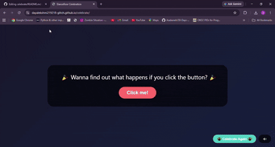

# 🎉 Ultimate Celebration Party

**An interactive celebration experience built to remind us to appreciate the little wins in life.**

<p align="center">
  <a href="https://dayalekshmi219218-glitch.github.io/celebrate/">
    <strong>🌐 LIVE DEMO — EXPERIENCE THE CELEBRATION!</strong>
  </a>
</p>

<p align="center">
  
</p>

---

## 💡 About the Project

Life can get pretty serious. We're constantly working towards goals, meeting deadlines, overcoming challenges, and thinking about what comes next. In the process, we sometimes forget to pause and appreciate how far we've come.

I built this project around a simple idea: **every achievement deserves to be celebrated, no matter how big or small.**

Whether you've landed a new job, completed a challenging assignment, learned something new, or simply made it through a difficult week, you deserve a moment to celebrate yourself.

This project is a small reminder not to take life too seriously, to enjoy the little things, and to make room for happiness along the way.

And what better way to celebrate than with fart phonk music, confetti, and an unreasonable number of dancing GIFs? 💃

## ✨ Features

- **Interactive Countdown:** Initiates a countdown when the user clicks the Celebrate button.
- **Background Audio:** Plays fart phonk music once the countdown finishes.
- **Confetti Animation:** Creates a confetti rain effect to kick off the celebration.
- **Dynamic GIF Generation:** Displays funny dancing GIFs at random positions across the screen, continuously multiplying throughout the celebration.
- **Live Dancer Counter:** Dynamically tracks the number of dancing GIFs displayed on screen.
- **Audio Controls:** Allows users to mute or unmute the background music.
- **Celebration Reset:** Restarts the entire experience, allowing users to celebrate as many times as they like.

## 📸 Project Preview

### Initial Screen


### Countdown Screen


### Celebration in Action


## 🔄 Application Workflow

1. **Initiate:** User clicks the Celebrate button.
2. **Countdown:** A countdown sequence begins.
3. **Music Playback:** Background music starts once the countdown reaches zero.
4. **Confetti Effect:** Confetti animation is triggered.
5. **GIF Generation:** Dancing GIFs begin appearing at random screen positions and multiply over time.
6. **Live Updates:** The dancer counter updates as new GIFs are generated.
7. **User Controls:** Users can mute the music or restart the entire celebration.

## 🎮 User Controls

| Control | Description |
|---|---|
| Celebrate | Initiates the celebration sequence |
| Mute / Unmute | Controls background music playback |
| Restart | Resets the celebration experience |

## 🧠 Technical Highlights

This project explores several fundamental frontend development concepts:

- **DOM Manipulation:** Dynamically creates and displays GIF elements on the screen.
- **Event-Driven Programming:** Handles user interactions through button events.
- **Timed Execution:** Coordinates countdowns, music playback and animation sequences.
- **Randomisation:** Generates dancing GIFs at random screen positions.
- **Audio Management:** Implements background audio playback and user-controlled mute functionality.
- **Dynamic UI Updates:** Updates the dancer counter as new GIFs are generated.
- **Application State Management:** Handles celebration states and resets the experience when requested.

## 🛠️ Technologies & Tools

- **HTML5** – Application structure and content.
- **CSS3** – Embedded styling, layout and visual effects.
- **JavaScript** – Embedded interactive functionality, event handling and dynamic elements.

## 📁 Project Structure

```text
celebrate/
│
├── asset/
│   ├── demo.mp4
│   ├── screenshot-home.jpg
|   ├── screenshot-countdown.jpg
│   └── screenshot-celebration.jpg
│
├── README.md
├── index.html
│
├── fart_phonk.mp3
├── funny_gif1.gif
├── funny_gif2.gif
└── funny_gif3.gif
```

## 🚀 Running Locally

1. Clone the repository:

   ```bash
   git clone https://github.com/dayalekshmi219218-glitch/celebrate.git
   ```

2. Navigate to the project directory:

   ```bash
   cd celebrate
   ```

3. Open `index.html` in your browser to experience the celebration!

## 🎯 Project Motivation

Beyond the technical experimentation, this project reflects a personal belief that life should not always revolve around productivity and achievement.

Taking a moment to appreciate yourself, celebrate progress, and have a little fun matters too.

**So go ahead, celebrate your wins. You've earned it!**

## ⚠️ Disclaimer

Side effects may include excessive laughter, spontaneous dancing, and an uncontrollable number of GIFs taking over your screen.

Enjoy responsibly. 🎉
